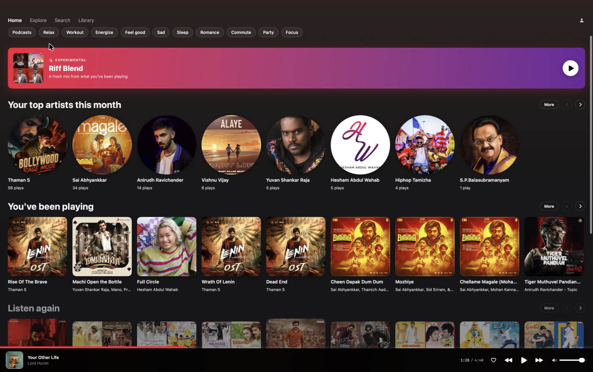
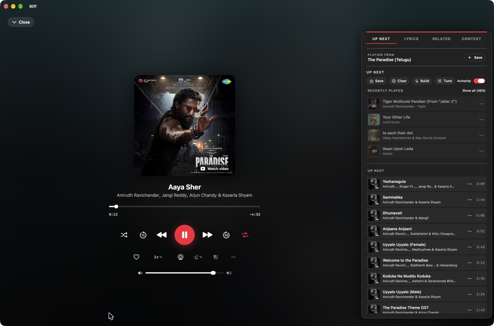
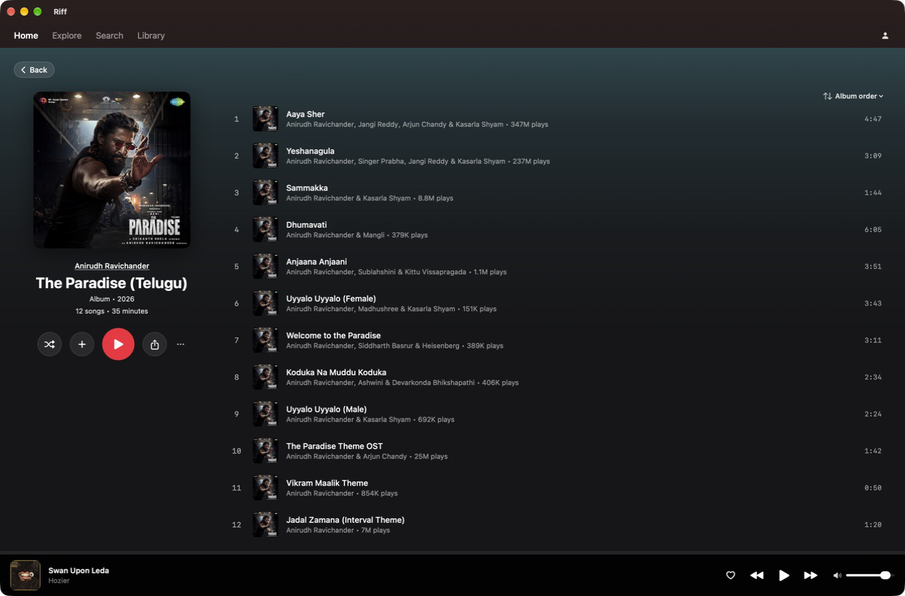
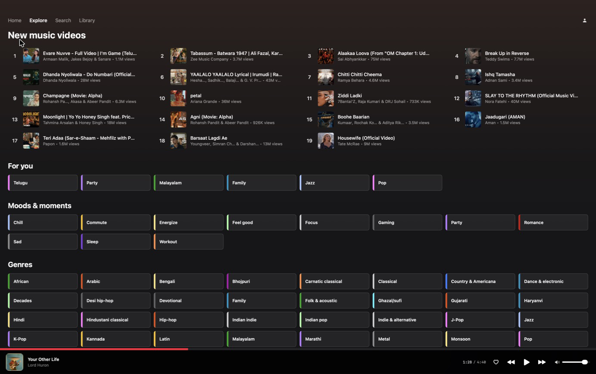
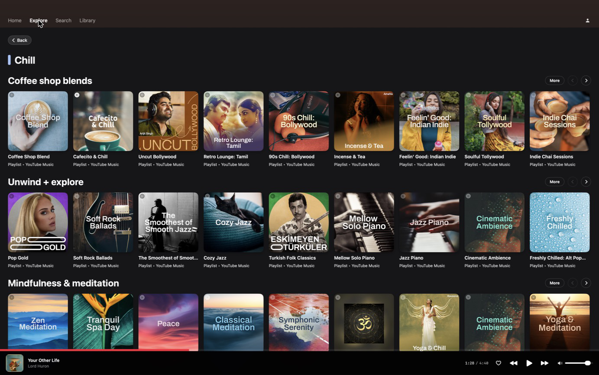
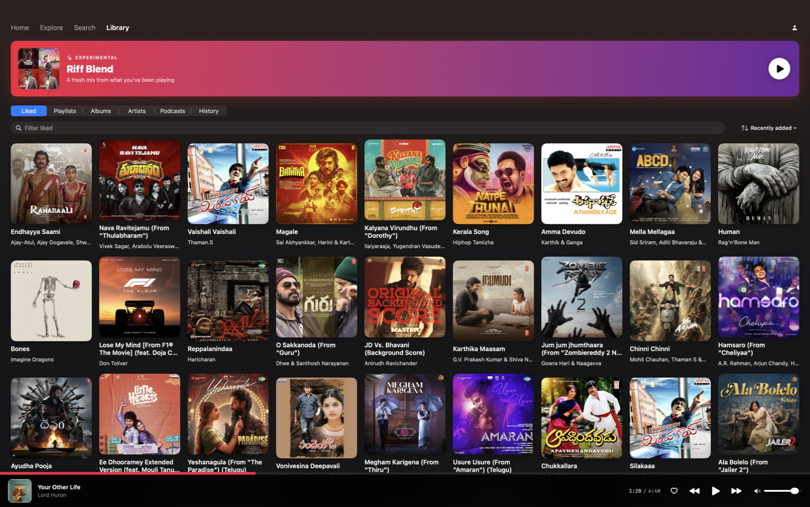
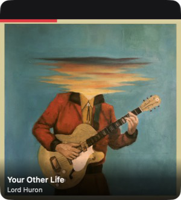

# Riff — a YouTube Music client for macOS

A native, open-source **YouTube Music desktop app for macOS**, built in SwiftUI, designed to feel like the YouTube Music **iOS** app — not Apple Music.

## Why this exists

There's no first-party YouTube Music app on the Mac App Store. The two leading open-source options each fall short:

- **[th-ch/youtube-music](https://github.com/th-ch/youtube-music)** is an Electron `BrowserWindow` wrapping `music.youtube.com`. It works, but it's a web page in a chrome.
- **[sozercan/kaset](https://github.com/sozercan/kaset)** is SwiftUI chrome around the same web page. It looks more native at a glance, but you can't click a thumbnail to play, and the UI ends up reading as a "cheap Apple Music clone."

This project inverts that architecture: **all** browse, search, library, and player UI is real SwiftUI fed by an InnerTube client. The WKWebView is **invisible** — it exists only to play audio, inside a hidden music.youtube.com page running with your own signed-in session (Premium included).

## Differentiators

- 🎯 **Click any thumbnail to play.** The single biggest gap in Kaset is filled here.
- 🎨 **YouTube Music iOS aesthetic.** Dark theme, large rounded thumbnails, generous spacing, red `#FF0033` accent — not Apple Music's sidebar.
- 🎙 **Podcasts as first-class.** YT Music's full catalogue (songs, albums, artists, playlists, podcasts), not just music.
- 🍎 **Siri / Shortcuts / Spotlight via App Intents.** *"Hey Siri, play my Focus playlist."*
- 🤖 **Bring-your-own-LLM** — paste an Anthropic or Groq key, point at any OpenAI-compatible endpoint, or run Ollama locally. Unlocks lyrics translation and X-Ray cards. The first YT Music client where the AI is fully under your control.
- 🔒 **Premium playback stays in the page.** Audio plays inside the hidden WebKit view with your session — no stream extraction, no fragile InnerTube `/player` workarounds.
- 🛠 **Open source under AGPL-3.0** — same license as ViMusic; prevents proprietary forks.

## Status

✅ **MVP + Phase 2 complete.** See [`PLAN.md`](PLAN.md), [`docs/PRODUCT_SPEC.md`](docs/PRODUCT_SPEC.md), and [`docs/ARCHITECTURE.md`](docs/ARCHITECTURE.md).

What works today:
- Sign-in (Safari-UA WebView cookie flow; an OAuth Device Flow implementation exists in the codebase but currently has no sign-in entry point in the UI — previously stored Device Flow tokens are still honoured)
- Home / Search / Library tabs — fully native SwiftUI, no embedded web pages
- Click any thumbnail to play (the YT-Music-iOS feel)
- Full-screen Now Playing with synced lyrics, Up Next queue, related rail
- Floating always-on-top mini player (⌥⌘M)
- macOS Now Playing integration + media-key support
- Tune popover wired to YT's real chip cloud (Familiar / Discover / Popular / mood / language variants)
- Like, add-to-playlist, create playlist, played history (persisted)
- Album / artist / playlist detail pages with "Releases for you" / "More like this" carousels
- Tappable artist names in album headers — pushes the artist page
- Standard track context menu (Play / Start radio / Play next / Add to queue / Go to album / Go to artist) on every row
- Keyboard shortcuts: Space play/pause, ⌘← → next/prev, ⌥⌘← → seek ±15/30s, ⌘↑↓ volume, ⌘L like, ⌘1/2/3 tabs
- Command palette (⌘K)
- Siri / Shortcuts / Spotlight via App Intents
- Opt-in Last.fm + ListenBrainz scrobbling
- Recap (local listening stats)
- BYO-LLM features (Anthropic, Groq, Ollama, or any OpenAI-compatible endpoint): lyrics translation and X-Ray cards
- Settings → Export diagnostics (a local dump you can attach to bug reports)
- MetricKit-based local crash + perf reporter (no telemetry leaves the device)

## Screenshots

| | |
|---|---|
|  *Home — personalized rails, mood chips, Riff Blend* |  *Now Playing — queue, lyrics, related, Autoplay* |
|  *Album pages — native SwiftUI, global play counts* |  *Explore — charts, moods & genres* |
|  *Mood category pages* |  *Library — liked songs, playlists, albums* |
|  *Floating Mini Player — stays on top, even over full-screen apps* | |

*Screenshots are captured by the maintainer from a signed-in build (they contain a personal library, so they're not generated in CI).*

## Roadmap

| Phase | Scope | Target |
|---|---|---|
| **MVP (Phase 1)** | Sign-in · Home · Search · read-only Library · click-to-play from thumbnails · Mini Now Playing bar · macOS Now Playing / media keys · YT Music iOS look | 3-4 weeks |
| **Phase 2** | Queue editing · Playlist editing · Synced lyrics · Album/Artist/Playlist detail pages · Dedicated Podcasts UX (speed, skip ±15/30s) · Floating mini player · Settings · History | 4-6 weeks |
| **Phase 3** | Smart radio · Activities/moods · AirPlay 2 · Multi-account · Background playback · EQ *(App Intents and BYO-LLM — Anthropic/Groq/Ollama/OpenAI-compatible — already shipped early)* | 2-3 months |
| **Phase 4** | Plugin system · advanced AI (hum-to-search, AI artwork) · cross-platform fork point | open-ended |

## Install

Download the `.dmg` (drag Riff to Applications) or the `.zip` from [Releases](https://github.com/thisizmvk/Riff/releases); `.sha256` checksums are attached to each. Until releases are Developer ID signed, first launch of an ad-hoc build needs an extra step: on macOS 14, right-click Riff.app and choose **Open**; on macOS 15 and later (which removed that bypass), launch it once, then go to **System Settings → Privacy & Security** and click **Open Anyway**.

## Building

```sh
brew install xcodegen
git clone https://github.com/thisizmvk/Riff.git
cd Riff
xcodegen generate
open Riff.xcodeproj
```

Then ⌘R in Xcode. `Riff.xcodeproj` is gitignored — [`project.yml`](project.yml) is the source of truth.

Runs on **macOS 14+**; building requires **Xcode 16+** (the generated project uses the Xcode 16 project format, objectVersion 77, which Xcode 15 can't open).

## Contributing

See [`CONTRIBUTING.md`](CONTRIBUTING.md). The single firm rule: the WKWebView never surfaces in the UI outside the sign-in sheet. Every browse / list / player surface must be real SwiftUI fed by `InnerTubeClient`. PRs that violate this will be rejected.

## Reporting a bug

Open a GitHub issue and, when it helps, attach the dump from **Settings → Export diagnostics** — it's written locally (to ~/Downloads) and nothing in it leaves your machine unless you attach it yourself.

## Architecture in one paragraph

SwiftUI app. All visible views are real SwiftUI — no embedded web pages. An `InnerTubeClient` (Swift, native) hits `music.youtube.com/youtubei/v1/{search,browse,next,player}` for data. A hidden, offscreen `WKWebView` loaded with `music.youtube.com` is the audio engine; SwiftUI controls it via `evaluateJavaScript`, and the page's MediaSession events bubble back through `WKScriptMessageHandler` into `MPNowPlayingInfoCenter`. Premium playback works because the page plays what YouTube Music serves the user's own signed-in session — Riff extracts no streams and handles no DRM itself. Full design rationale: [`docs/ARCHITECTURE.md`](docs/ARCHITECTURE.md).

## Privacy and Security

Riff ships no telemetry of any kind. Your Google session cookies stay in the local cookie jars (the WKWebView data store and `HTTPCookieStorage`) and are sent only to YouTube Music's own endpoints; API keys you paste for the BYO-LLM features are stored in the macOS Keychain. The MetricKit crash/perf reporter and the Settings → Export diagnostics dump are strictly local — nothing leaves your machine unless you attach it to a bug report yourself.

## Disclaimer

This project is not affiliated with, endorsed by, or sponsored by Google or YouTube. Users supply their own Google/YouTube account and must comply with YouTube's Terms of Service. The app does not download, redistribute, or DRM-strip any audio.

## License

AGPL-3.0. See [`LICENSE`](LICENSE).
